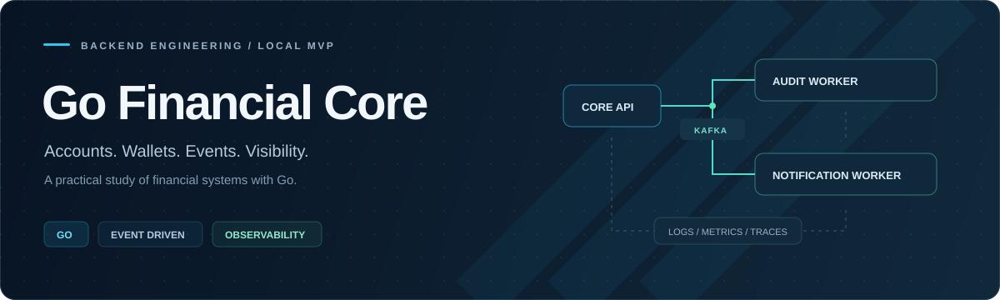
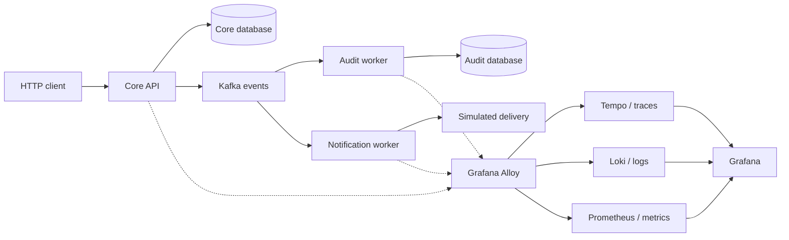

<div align="center">



<p><strong>A financial backend MVP for studying Go, distributed systems, and observability.</strong></p>

<a href="https://github.com/didiegovieira/go-financial-core/actions/workflows/ci.yml"></a>


<p>
<a href="#overview">Overview</a> &nbsp;&middot;&nbsp;
<a href="#architecture">Architecture</a> &nbsp;&middot;&nbsp;
<a href="#quick-start">Quick start</a> &nbsp;&middot;&nbsp;
<a href="#observability">Observability</a> &nbsp;&middot;&nbsp;
<a href="#api">API</a> &nbsp;&middot;&nbsp;
<a href="docs/RUNBOOK.md">Runbook</a>
</p>

</div>

---

## Overview

Go Financial Core models accounts and wallets with a synchronous HTTP API and
asynchronous Kafka workers. It is a hands-on study of business rules, persistence,
service boundaries, and the operational visibility needed to understand a request
across applications.

| Capability | What is implemented |
| --- | --- |
| Accounts | Create, find, and delete accounts by phone |
| Wallets | Credit and debit operations, balance validation, and debit risk policy |
| Events | Kafka publication for account and wallet activity |
| Audit | Worker persists audit records in PostgreSQL |
| Notifications | Worker processes events through a simulated delivery client |
| Observability | Correlated logs, metrics, traces, and filtered Grafana dashboards |

> **Project note**
>
> This is a **local MVP and study project**. Notification delivery is simulated.
> Production security and event-delivery guarantees remain future work.

## Architecture

Three applications, one Go module, explicit domain boundaries.



Core and audit use separate databases in the same local PostgreSQL instance.
Alloy receives OTLP traces and metrics and collects container logs through Docker.

| Layer | Responsibility |
| --- | --- |
| Domain | Entities, errors, events, and business policies |
| Application | Use cases, DTOs, orchestration, and dependency ports |
| Infrastructure | HTTP, PostgreSQL, Kafka, migrations, and external clients |
| Composition | Wire providers and application entrypoints |

<details>
<summary><strong>Explore the repository</strong></summary>

```text
apps/
  core/             HTTP API for accounts and wallets
  audit/            Kafka audit worker
  notification/     Kafka notification worker
pkg/
  telemetry/        SDK setup, tracing, metrics, logs, and propagation
  messaging/kafka/  Shared Kafka transport
  ...               API, logging, validation, and shared utilities
docker/
  postgres/         Database bootstrap and optional demo seeds
  observability/    Alloy, Tempo, Loki, Prometheus, and Grafana
docs/               Local runbook and README assets
.github/workflows/  CI and manual vulnerability scanning
```

Repository conventions: [AGENTS.md](AGENTS.md).
Operational procedures: [docs/RUNBOOK.md](docs/RUNBOOK.md).

</details>

## Quick start

**Requirements:** Docker with Compose v2, Make, and Go **1.25.6** for host execution
and development. Dependency generation also requires Wire.

```sh
# Build and start the local stack
make up

# Check initialization and migrations before using the API
docker compose logs --tail=100 financial-core audit notifications

# Optional: load synthetic demo accounts and balances
make seed
```

| Open locally | Address |
| --- | --- |
| API health | [localhost:8080/v1/financial/health](http://localhost:8080/v1/financial/health) |
| Swagger | [localhost:8080/docs/financial/index.html](http://localhost:8080/docs/financial/index.html) |
| Grafana | [localhost:3000](http://localhost:3000) |

> **Before you start**
>
> Container startup does not guarantee completed migrations or Kafka readiness.
> Check application logs first. SQL seeds write directly to PostgreSQL and do not
> publish events; use the API to exercise the workers.

When finished:

```sh
make down
```

This stops services while preserving containers and named-volume data.

<details>
<summary><strong>Need a fresh local environment?</strong></summary>

> **Destructive reset**
>
> `make drop` deletes containers, networks, and volumes, including database,
> Kafka, and observability data. Use it only for an intentional reset.

After a reset, run `make up`, check initialization, then optionally `make seed`.
See [data handling and recovery](docs/RUNBOOK.md) before changing existing data.

</details>

## Observability

Follow a request from the API through Kafka into audit and notification processing.
All three apps use the **official OpenTelemetry Go SDK**, centralized in
[`pkg/telemetry`](pkg/telemetry).

| Signal | Collection and storage | What to investigate |
| --- | --- | --- |
| Logs | Docker stdout/stderr &rarr; Alloy &rarr; Loki | HTTP outcomes and worker processing, correlated by `trace_id` |
| Metrics | OpenTelemetry &rarr; Alloy &rarr; Prometheus | Request volume, status codes, handler outcomes, and latency |
| Traces | OpenTelemetry &rarr; Alloy &rarr; Tempo | Spans across HTTP, use cases, repositories, and workers |

### Your investigation workspace

| Dashboard | Purpose |
| --- | --- |
| [Overview](http://localhost:3000/d/financial-overview) | HTTP/Kafka volume, outcomes, latency, and logs from all apps |
| [Failures](http://localhost:3000/d/financial-failures) | HTTP failures, worker handler errors, and warning/error logs |
| [Investigation](http://localhost:3000/d/financial-investigation) | Logs and traces filtered by service, text, span, and duration |

Grafana opens with anonymous **Editor** access for local exploration. Use the
filters at the top of each dashboard and adjust the time range to your requests.

> **Investigation tip**
>
> Expand a JSON operational log and click **View trace**. You can also copy the
> API response's `X-Trace-ID` into [Explore](http://localhost:3000/explore) with
> **Tempo** selected. Choose **Loki** there to query logs directly.

[Collection and configuration](docs/RUNBOOK.md#grafana-observability-mvp)
&middot; [Dashboard filters](docs/RUNBOOK.md#dashboard-filters)
&middot; [Troubleshooting](docs/RUNBOOK.md#troubleshooting)

## API

Base path: `/v1/financial`. Wallet amounts are integer **cents**.

| Method | Route | Operation |
| --- | --- | --- |
| `GET` | `/health` | Application liveness |
| `POST` | `/accounts` | Create an account and wallet |
| `GET` | `/accounts?phone=...` | Find an account |
| `DELETE` | `/accounts` | Delete an account by phone |
| `POST` | `/wallets/credits` | Credit an active wallet |
| `POST` | `/wallets/debits` | Debit a wallet subject to balance and risk checks |

See [Swagger](http://localhost:8080/docs/financial/index.html) for payloads and
responses. The health endpoint does not verify database or Kafka connectivity.

## Development

The stack combines **Gin**, **PostgreSQL**, **Kafka**, **OpenTelemetry**, **Grafana**,
**Logrus**, **Swagger**, **Wire**, **GoMock**, and **Testify**.

```sh
go test ./...
go vet ./...
go build ./...
```

<details>
<summary><strong>Code generation and host execution</strong></summary>

| Command | Purpose |
| --- | --- |
| `make wire` | Regenerate dependency injection for all three apps |
| `make docs-core` | Regenerate Swagger documentation |
| `make mocks-linux` | Regenerate mocks on Linux/macOS |
| `make mocks-windows` | Regenerate mocks on Windows PowerShell |
| `make run-core` | Run the API on the host |

Use the [host configuration instructions](docs/RUNBOOK.md#configuration) before running
outside Compose; Kafka currently advertises its internal service address.

</details>

### Automated checks

CI runs on direct pushes to `main`, optional PRs targeting `main`, and manual
execution. It checks formatting, `vet`, tests with race detection, builds, and
Compose configuration. PRs are not required by this setup.

The **Go vulnerabilities** workflow runs manually from GitHub Actions. Existing
toolchain and dependency findings are pending remediation. See
[repository automation](docs/RUNBOOK.md#repository-automation) for details.

## Engineering roadmap

Next areas of study, beyond the current MVP:

- Integration tests that start the stack and validate complete financial flows.
- Transactional outbox/inbox and idempotent event processing.
- Stronger financial transaction guarantees and concurrency validation.
- Application retries, dead-letter handling, and controlled reprocessing.
- Authentication, authorization, dependency remediation, and production hardening.
- Kafka lag visibility, service-level objectives, alert rules, and service graphs.

> **Project note**
>
> The current deployment uses development credentials, anonymous Grafana access,
> unauthenticated telemetry backends, and single-instance local storage. Worker
> metrics measure handler completion, not lag or offset commits. A database write
> can succeed before event publication fails.

## License

Licensed under the [MIT License](LICENSE). Copyright (c) 2026 didiegovieira.

---

<div align="center">
<strong>Build it. Trace it. Understand it.</strong><br />
<sub>A practical learning project by <a href="https://github.com/didiegovieira">@didiegovieira</a>.</sub>
<p><a href="https://github.com/didiegovieira">GitHub</a> &middot; <a href="https://www.linkedin.com/in/didiegovieira/">LinkedIn</a></p>
</div>
